# Dokumentasi & Flowchart Alur Kerja Modul Marketing — PT Trimitra Tumbuh Cemerlang (TTC)

Dokumen ini menjelaskan alur bisnis dan teknis dari **Modul Marketing** pada sistem ERP PT Trimitra Tumbuh Cemerlang (TTC), mulai dari manajemen data pelanggan, persetujuan spesifikasi produk (*Approval Form*), penyusunan *Bill of Materials* (BOM), kalkulasi HPP & penawaran harga (*Order Confirmation*), hingga penerbitan *Sales Order* dan pemenuhan pesanan ke produksi (SPK) maupun pengiriman (Surat Jalan).

---

## 1. Flowchart Utama Modul Marketing

```mermaid
flowchart TD
    %% Master Data Awal
    A["1. Master Customer<br/>(Data Pelanggan & Kode Customer)"] --> B{"Tipe Pesanan?"}

    %% Jalur Pesanan Baru vs Repeat Order
    B -- "Produk Baru / Revisi Desain" --> C["2. Approval Form (AF)<br/>Input Spesifikasi Teknis: Jenis, Kertas,<br/>Dimensi (cm), Warna, Finishing & Qty"]
    B -- "Repeat Order<br/>(Produk Sudah Ada)" --> G["4. Order Confirmation (OC)<br/>(Buat Penawaran Harga)"]

    %% Proses BOM & Finish Good di Approval Form
    C --> D{"Cek Kesiapan BOM<br/>& Finish Good"}
    D -- "Belum Ada BOM" --> E["Aksi: Set BOM Finish Good<br/>(Pilih Material Kertas, Tinta, Plate, dll)"]
    E --> F["3. Master Finish Good Item<br/>Terbentuk Otomatis + Resep BOM Lengkap<br/>(Status AF: BOM LENGKAP)"]
    D -- "BOM Sudah Lengkap" --> F

    %% Konversi AF ke Order Confirmation
    F --> G1["Aksi: Generate Order Confirmation<br/>(Otomatis Tarik Item & Spesifikasi AF)"]
    G1 --> G

    %% Kalkulasi HPP di dalam Order Confirmation
    G --> H["Kalkulator HPP & Kertas (Mesin Flexo Zonten)<br/>- Layout Repeat Cylinder & Pitch (cm)<br/>- Kebutuhan Kertas (Meter & Kg) + Waste<br/>- Biaya Proses Cetak, Overhead & Margin"]
    H --> I{"Penetapan Harga<br/>Satuan Item"}
    I -- "Harga Indikatif (+Margin)" --> J["Review & Cetak PDF Penawaran OC"]
    I -- "Samakan HPP (Margin 0%)" --> J
    I -- "Fix HPP Manual" --> J

    %% Status Deal Customer pada OC
    J --> K{"Keputusan Customer?"}
    K -- "Revisi Harga / Diskon" --> G
    K -- "Ditolak" --> L["Status OC: DITOLAK"]
    K -- "Disetujui (Deal)" --> M["Aksi: Deal -> Create Sales Order (SO)<br/>(Status OC: SEMUA SO TERBIT)"]

    %% Sales Order & Alokasi Buffer Stock
    M --> N["5. Sales Order (SO)<br/>Sistem Otomatis Cek Stok Gudang Barang Jadi"]
    N --> O{"Cek Ketersediaan<br/>Finish Good Stock"}

    %% 3 Skema Pemenuhan Sales Order
    O -- "Stok Gudang >= Qty Pesanan" --> P["Sumber Pemenuhan: STOK GUDANG (SIAP KIRIM)<br/>(Tidak Perlu Buat SPK Produksi)"]
    O -- "0 < Stok Gudang < Qty Pesanan" --> Q["Sumber Pemenuhan: PARSIAL (STOK + SPK)<br/>(Alokasi Stok Tersedia + Buat SPK Selisihnya)"]
    O -- "Stok Gudang = 0" --> R["Sumber Pemenuhan: PRODUKSI SPK<br/>(Produksi Penuh Sesuai Qty SO)"]

    %% Hilir ke PPIC, Dispatch, dan Finance
    Q --> S["Modul PPIC: Buat Master SPK<br/>(Produksi Internal / Subcount Maklon)"]
    R --> S
    S --> T["Proses Produksi<br/>(Pra Cetak -> Printing -> Finishing -> Gudang)"]
    T --> U["Modul Dispatch: Buat Surat Jalan (SJ)"]
    P --> U
    U --> V["Modul Finance: Terbit Invoice & Penagihan"]
```

---

## 2. Flowchart Detail Kalkulator HPP & Kertas (Mesin Flexo Zonten)

```mermaid
flowchart LR
    subgraph Input_Layout["A. Spesifikasi & Layout (CM)"]
        A1["Panjang & Lebar Etiket Jadi (cm)"]
        A2["Repeat Cylinder Standar (41.28 cm)"]
        A3["Allowance Panjang (0.3 cm), Lebar (0.3 cm), Web (2.0 cm)"]
        A4["Jumlah Etiket Sepanjang Repeat & Jalur Lebar"]
    end

    subgraph Input_Bahan["B. Kebutuhan Bahan Kertas"]
        B1["Gramatur Kertas (GSM)"]
        B2["Harga Bahan per Meter (Rp/m) <-> per Kg (Rp/kg)"]
        B3["Waste Setting Awal (m) + Waste Tambahan (%)"]
    end

    subgraph Input_Proses["C. Biaya Proses Flexo"]
        C1["Kecepatan Cetak (m/menit) & Waktu Setup (menit)"]
        C2["Tarif Mesin/Jam, Tinta, Plate/Cliche & Tenaga Kerja"]
    end

    subgraph Output_HPP["D. Ringkasan HPP & Harga Jual"]
        D1["Total Biaya Order (Rp) + Kalimat Terbilang"]
        D2["HPP Pokok per Etiket (Rp/pcs)"]
        D3["Harga Jual Indikatif (+Margin %)"]
        D4["Pengaturan Fix HPP / Sinkronisasi Harga Satuan"]
    end

    Input_Layout --> Input_Bahan --> Input_Proses --> Output_HPP
```

---

## 3. Penjelasan 5 Sub-Modul Utama Marketing

### 1. Master Customer (`CustomerResource`)
- **Fungsi:** Mengelola data pelanggan (Kode Customer, Nama Perusahaan, Alamat Pengiriman, NPWP, PIC, dan Termin Pembayaran).
- **Integrasi:** Kode customer digunakan secara otomatis pada format penomoran dokumen `Approval Form (AF)`, `Order Confirmation (SC/OC)`, dan `Sales Order (OR/SO)`.

### 2. Approval Form / AF (`ApprovalFormResource`)
- **Fungsi:** Mencatat persetujuan spesifikasi teknis pesanan etiket dari pelanggan (Jenis SKM/SKT, Komponen, Isi/Batang, Jenis Kertas, Jumlah Warna, Finishing, dan Kuantitas).
- **Validasi BOM & Finish Good:**
  - Memiliki indikator **Kesiapan BOM** (`BOM LENGKAP` / `BELUM SET BOM`).
  - Menyediakan aksi **Set BOM Finish Good** untuk langsung mendaftarkan produk jadi ke katalog `Finish Good Items` beserta komposisi bahan bakunya.
  - Menyediakan aksi **Generate Order Confirmation** untuk menarik seluruh item AF menjadi draf penawaran harga. Jika Finish Good dan OC sudah terbit, tombol aksi pembuatan otomatis disembunyikan untuk mencegah duplikasi.

### 3. Finish Good Items (`FinishGoodItemResource`)
- **Fungsi:** Menyimpan master produk barang jadi milik customer beserta ukuran dimensi (`panjang`, `lebar`, `gramasi`) dan resep **Bill of Materials (BOM)**.
- **Integrasi:** Digunakan oleh modul **Order Confirmation** (sebagai acuan dimensi awal kalkulasi HPP), modul **PPIC (Master SPK)**, dan modul **Warehouse (`FinishGoodStock`)**.

### 4. Order Confirmation / OC (`OrderConfirmationResource`)
- **Fungsi:** Menyusun dokumen konfirmasi penawaran harga resmi kepada pelanggan.
- **Fitur Utama:**
  - **Kalkulator HPP & Kertas (Mesin Flexo Zonten):** Menghitung kelayakan layout repeat cylinder dalam satuan **cm**, total kebutuhan kertas dalam **meter** & **kg**, sinkronisasi harga bahan kertas per meter (`Rp/m`) dan per kilogram (`Rp/kg`), biaya proses cetak, kalimat *Terbilang*, serta rekomendasi harga jual.
  - **Pengaturan Harga & Fix HPP:** Memungkinkan user menggunakan harga indikatif (+margin), menyamakan harga jual dengan HPP pokok (margin 0%), atau mengunci nilai **Fix HPP manual** agar HPP dan harga satuan sama persis.
  - **Konversi ke Sales Order:** Tombol **Deal → Create SO** secara otomatis menerbitkan dokumen *Sales Order* untuk seluruh item pada OC.

### 5. Sales Order / SO (`SalesOrderResource`)
- **Fungsi:** Dokumen pesanan penjualan resmi yang menjadi acuan kerja departemen PPIC, Gudang (*Warehouse*), Pengiriman (*Dispatch*), dan *Finance*.
- **Fitur Utama:**
  - **Pop-up Rincian OC:** Klik pada kolom badge `No OC` akan menampilkan modal ringkasan dokumen OC, spesifikasi item, kalkulasi mesin Flexo, dan grand total penawaran.
  - **Alokasi Buffer Stock Otomatis (`Sumber Pemenuhan`):**
    1. **Stok Gudang (Siap Kirim):** Jika stok barang jadi (`FinishGoodStock`) mencukupi, pesanan dapat langsung dibuatkan **Surat Jalan** tanpa perlu memproduksi ulang lewat SPK.
    2. **Parsial (Stok + SPK):** Mengalokasikan stok gudang yang tersedia dan hanya menerbitkan SPK untuk jumlah kekurangannya.
    3. **Produksi SPK:** Jika stok gudang kosong (`0`), pesanan diteruskan ke modul **PPIC** untuk diterbitkan **Surat Perintah Kerja (SPK)** (baik produksi internal maupun *Subcount / Maklon*).
