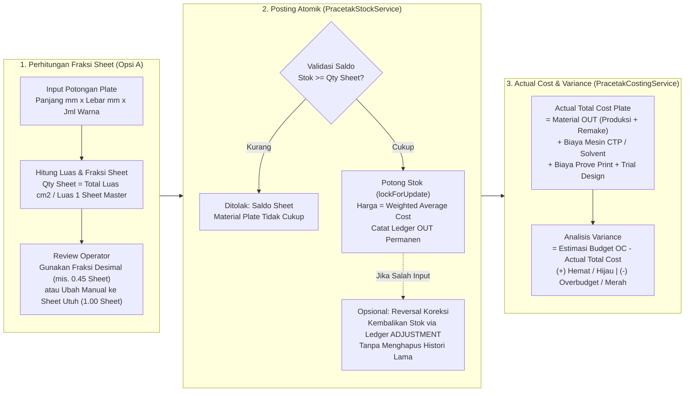

# Dokumentasi & Flowchart Alur Kerja Modul Pra Cetak (Prepress Flexo) — PT Teknografi Tri Cawanaska (TTC)

Dokumen ini menjelaskan alur bisnis, pemetaan 4 submenu utama **Modul Pra Cetak**, mekanisme persediaan bahan plate mentah yang terisolasi 100% dari Warehouse Printing, kalkulasi HPP & harga jual plate (*Dual-Phase Costing*), hingga arsip plate jadi untuk *Repeat Order* pada sistem ERP PT TTC.

---

## 1. Flowchart Utama Modul Pra Cetak (End-to-End 4 Submenu)

```mermaid
flowchart TD
    %% 1. Persiapan & Stok Material Plate (Submenu 2 + Alur Baku PR -> PO -> LPB)
    subgraph SUB2_3["Submenu 2 + Alur Pembelian Baku PR -> PO -> LPB -> PO Billing"]
        M1["Submenu 2: Material & Stok Plate\nDaftar Master Plate: Kode, Brand, Tebal mm, Ukuran Sheet P x L, Harga Acuan\nAuto-Sync ke MasterItem [PLATE] | Saldo Realtime, Weighted Avg & Nilai Persediaan"]
        M2["Alur Pembelian Baku: PR -> PO -> Penerimaan Barang (LPB)\nPilih Item [PLATE] bersama/terpisah dari Kertas & Tinta\nLanjut ke Finance: PO Billing (Hutang AP)"]
        M3{"Auto-Routing Stok di LPB\n(Item Plate vs Material Umum)"}
        M4["Saldo Stok Plate Bertambah (IN)\nHitung Weighted Average Cost dari Harga PO\nCatat Ledger Immutable di Buku Besar Mutasi Plate\n(Opsional: Saldo Awal / Terima Manual tanpa PO)"]

        M1 -->|"Auto-Sync [PLATE] untuk dipilih di PR/PO"| M2
        M2 --> M3
        M3 -->|"Material Plate Mentah"| M4
        M4 -.->|"Update Saldo Realtime di Tabel"| M1
    end

    %% 2. Integrasi Hulu: Marketing & PPIC
    subgraph HULU["Integrasi Hulu: Alur Baku Marketing & PPIC"]
        H1["Approval Form\nCek Otomatis Arsip Plate Repeat Order"]
        H2["Order Confirmation (Kalkulator HPP Flexo)\nPilih Plate Baru (Hitung Luas cm2 x Harga Rata-rata)\natau Repeat Order (Arsip Rak = Rp 0)"]
        H3{"Strategi Pembebanan\nBiaya Plate ke Harga Jual"}
        H3A["Include in HPP\nLebur ke HPP Pokok / Pcs"]
        H3B["Separate Charge\nTagih Terpisah di Ringkasan OC & PDF"]
        H4["Sales Order -> Master SPK\nKlik Aksi: Buat / Buka Proses Pra Cetak"]

        H1 --> H2
        H2 --> H3
        H3 -->|"Amortisasi ke Qty"| H3A --> H4
        H3 -->|"Cliché Charge"| H3B --> H4
    end

    M1 -.->|"Tarik Ukuran Sheet & Harga Rata-rata"| H2

    %% 3. Eksekusi 4 Tahap Pra Cetak (Submenu 1)
    subgraph SUB1["Submenu 1: Proses Pra Cetak (Dashboard KPI, 2 Grafik & Eksekusi 4 Tahap)"]
        P0["Input / Auto-Prefill dari SPK\nTarik Estimasi Budget Plate OC, Warna & Status Repeat Order\n(Opsional: Pre-Order Trial/Prove dari Approval Form)"]
        PA["Tahap A: Trial Design\nCek File Desain, Kesiapan Cetak, Toleransi Hasil & Biaya Setting"]
        PB["Tahap B: Prove Print\nCetak Sampel Bahan Khusus, Status ACC/Revisi, Upload Bukti Prove & Biaya Prove"]
        PG{"Validasi SPK\nSebelum Plate Making"}
        PC["Tahap C: Plate Making & Potong Stok\nRincian Warna, Operator & Mesin CTP (Tarif/Plate)\nInput Pemakaian Material (Produksi / Remake Rusak)\nAuto Hitung Fraksi Sheet cm2 (Bisa Override ke Utuh)"]
        POST["Aksi: Posting Potong Stok Plate (OUT)\nPotong Saldo Sheet Desimal + Catat Ledger OUT\nHitung Actual Cost & Variance vs Budget OC"]
        PD["Tahap D: Penyimpanan & Finishing\nInput Hasil Baik/Rusak, Lokasi Rak, Material Pendukung\n(Pisau Pond, Film UV, Emboss) & Toleransi Rusak/Hilang"]

        P0 --> PA --> PB --> PG
        PG -->|"SPK Belum Terhubung"| PG_WAIT["Terkunci: Hubungkan SPK Dahulu\n(Anti-Rugi Potong Stok Sebelum Deal)"]
        PG -->|"SPK Valid"| PC
        PC --> POST --> PD
    end

    H4 --> P0
    H1 -.->|"Opsional Pre-Order"| P0
    POST -.->|"Kurangi Saldo Stok & Catat Ledger OUT"| M1

    %% 4. Arsip Plate Jadi & Hilir Printing (Submenu 4 + 1 Pintu IMR Printing)
    subgraph SUB4["Submenu 4: Arsip & Rak Plate + 1 Pintu Pengeluaran via IMR Printing"]
        A1["Submenu 4: Arsip & Rak Plate\nKode Otomatis PLT-YYYY-0001\nStatus: Tersimpan di Rak (Siap Pakai)"]
        A2A["Printing: Buat IMR Printing\nAuto-Deteksi Plate Siap di Rak + Request Material Gudang\nApprove IMR (Material + Persetujuan Plate)"]
        A2["Warehouse: Pengeluaran Material (Issue)\n1 Pintu Keluar Bahan Baku & Serah Terima Plate\nCatat Penerima | Counter +1 | Status: Dipakai Printing"]
        A3["Modul Printing Flexo\nTampil Banner Otomatis: Status Plate & Lokasi Rak"]
        A4{"Kondisi Plate\nSetelah Selesai Cetak"}
        A5["Kembalikan ke Rak\nStatus: Tersimpan (Siap Repeat Order)"]
        A6["Lapor Rusak / Hilang\nStatus: Perlu Remake / Rusak"]

        A1 --> A2A --> A2 --> A3 --> A4
        A4 -->|"Baik"| A5
        A4 -->|"Rusak / Melewati Toleransi"| A6
    end

    PD -->|"Selesai & Simpan ke Rak"| A1
    A5 -.->|"Deteksi Repeat Order Rp 0"| H1
    A5 -.->|"Pilihan Plate Arsip di HPP"| H2
```

---

## 2. Flowchart Detail Pemotongan Stok Plate (Fraksi Sheet), Costing & Reversal

---

## 3. Penjelasan 3 Submenu Inti Modul Pra Cetak

Seluruh fitur prepress kini diringkas menjadi **3 submenu inti** di sidebar `PRA CETAK` karena pembelian & penerimaan plate mentah sudah menyatu ke alur baku **`Purchase Request → Purchase Order → Penerimaan Barang (LPB) → PO Billing`**:

### 1. Proses Pra Cetak (`PracetakProcessResource.php`)
- **Peran:** Pusat monitoring & eksekusi harian operator prepress.
- **Dashboard Terintegrasi (Header Page):**
  - 4 KPI Card: *Antrean Aktif Pra Cetak*, *Stok Material Plate & Nilai Persediaan*, *Arsip Plate Aktif & Rasio Kerusakan (%)*, serta *Variance HPP Plate*.
  - 2 Grafik: *Distribusi Proses per Tahap (A–E)* (`PracetakStageChart`) dan *Posisi Saldo Stok Material Plate* (`PracetakStockChart`).
- **4 Tahap Operasional + Serah Terima:**
  - **A. Trial Design:** Preview desain langsung dari `Approval Form`, cek ketersediaan & kesiapan file, toleransi hasil, dan biaya desain aktual.
  - **B. Prove Print:** Uji cetak sampel bahan khusus, status ACC/Revisi, upload bukti arsip prove (foto/PDF), dan biaya prove aktual.
  - **C. Plate Making & Stok:** Detail warna/separasi, operator & mesin CTP (bisa tambah Master Mesin/Operator langsung via ikon `+` di dropdown atau tombol *Master Mesin & Operator* di header), repeater pemakaian bahan plate (produksi normal / remake rusak / prove), tombol **Posting Potong Stok Plate (OUT)**, dan kartu **Actual Cost vs Budget OC**.
  - **D. Penyimpanan & Serah Terima:** Pendataan lokasi rak, arsip material pendukung finishing (pisau pond, film UV, emboss), toleransi rusak/hilang, sinkronisasi otomatis ke **Arsip & Rak Plate**, serta pintasan **Ajukan IMR Printing** karena serah terima plate ke Printing berjalan 1 pintu ketat melalui **IMR Printing → Warehouse Pengeluaran Material**.

### 2. Material & Stok Plate (`MasterMaterialPlateResource.php`)
- **Peran:** Satu pintu untuk katalog master bahan mentah plate, pemantauan saldo stok realtime, dan audit mutasi.
- **Fitur Gabungan:**
  - Menyatukan *Master Material Plate*, *Stok Material Plate*, dan *Histori Mutasi* dalam satu tampilan tabel (menampilkan kode, brand, tebal mm, ukuran sheet `P × L`, **Saldo Stok Desimal**, **Harga Rata-rata / Sheet**, dan **Nilai Persediaan**).
  - Filter cepat **Stok Tersedia (> 0)** dan **Stok Kritis (≤ 5 Sheet)**.
  - Tab **Histori Mutasi Plate (Ledger IN / OUT)** langsung di dalam detail (*View/Edit*) setiap material (`MovementsRelationManager`), plus tombol header **Buku Besar Mutasi (Ledger)** untuk melihat seluruh riwayat gabungan lintas material.
  - Dilengkapi proteksi `guardDelete` agar material yang sudah pernah bertransaksi tidak bisa dihapus sembarangan.

### 3. Penerimaan Plate (`PracetakPenerimaanResource.php`)
- **Peran:** Mencatat transaksi pembelian/kedatangan fisik sheet plate mentah dari supplier.
- **Mekanisme Kerja:**
  - Nomor penerimaan otomatis per tahun (`PRE-2026-0001`), pencatatan No. Surat Jalan & No. Invoice Supplier, serta snapshot spesifikasi & harga beli aktual.
  - Alur `Draft` → klik **Posting** (`PracetakStockService::postPenerimaan`) dengan *pessimistic locking* untuk menambah saldo stok, memperbarui *Weighted Average Cost*, mencatat mutasi `IN` di ledger, dan mengunci dokumen menjadi *read-only*.

### 4. Arsip & Rak Plate (`PracetakPlateArchiveResource.php`)
- **Peran:** Inventaris aset **plate jadi** milik customer yang tersimpan di rak pabrik.
- **Manfaat Bisnis:**
  - Terbuat/diperbarui otomatis saat Tahap D di *Proses Pra Cetak* diselesaikan (kode `PLT-YYYY-0001`).
  - Menyimpan lokasi rak, jumlah & rincian warna, material pendukung finishing (pisau pond, film UV), counter jumlah pemakaian (*repeat*), dan status kondisi (`Tersimpan di Rak`, `Dipakai Printing`, `Perlu Remake`, `Rusak / Hilang`, `Retired`).
  - Terhubung langsung ke **Approval Form**, **Order Confirmation** (deteksi *Repeat Order* agar biaya plate = `Rp 0`), dan **Printing** (menampilkan status kesiapan & nomor rak plate saat SPK dipilih).

---

## 4. Service Engine Pendukung
- **`PracetakStockService.php`:** Menangani perhitungan fraksi sheet (`calculateSheetFraction`), posting penerimaan `IN` (`postPenerimaan`), pemotongan stok `OUT` (`postMaterialUsage` & `postAllDraftUsages`), serta pembatalan aman (`reverseMaterialUsage`) dengan transaksi database atomik & *row-level locking*.
- **`PracetakCostingService.php`:** Menangani estimasi HPP plate untuk `FlexoHppCalculatorService` (`estimatePlateCost`), rekalkulasi biaya aktual & variance (`recalculateProcessCost`), sinkronisasi arsip rak (`syncPlateArchive`), serah terima ke Printing (`handOverToPrinting`), dan auto-prefill SPK dari Order Confirmation (`resolveEstimatedPlateFromSpk`).
