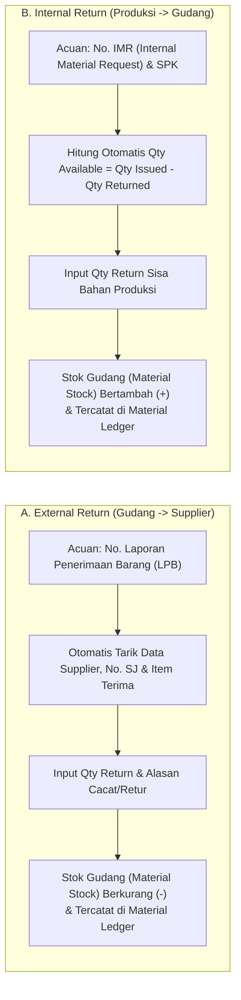

# Dokumentasi & Flowchart Alur Kerja Modul Purchasing — PT Trimitra Tumbuh Cemerlang (TTC)

Dokumen ini menjelaskan alur bisnis dan teknis dari **Modul Purchasing (Pengadaan & Retur Material)** pada sistem ERP PT Trimitra Tumbuh Cemerlang (TTC), mulai dari pengelolaan master data material & supplier, pengajuan *Purchase Request (PR)*, penerbitan *Purchase Order (PO)*, penerimaan barang di gudang (*LPB*), penanganan retur (*External Return* & *Internal Return*), hingga penagihan faktur pembelian (*PO Billing*) di modul Finance.

---

## 1. Flowchart Utama Modul Purchasing (End-to-End)

```mermaid
flowchart TD
    %% Master Data Awal
    subgraph Master_Data["1. Master Data Purchasing"]
        M1["Category Item & Type Item<br/>(Klasifikasi Bahan Baku)"]
        M2["Master Satuan & Master Konversi<br/>(Kg, Meter, Roll, Lembar, Pcs)"]
        M3["Master Item<br/>(Katalog Material, Kode & Dimensi)"]
        M4["Master Supplier<br/>(Data Vendor & Pemasok)"]
        M1 --> M3
        M2 --> M3
    end

    %% Tahap Purchase Request (PR)
    M3 --> A["2. Purchase Request (PR)<br/>Diajukan oleh Departemen (Gudang / PPIC / Produksi)<br/>Input: Departemen, Tanggal PR, Daftar Item, Qty & ETA"]
    A --> B{"Otorisasi PR?"}
    B -- "Belum / Revisi" --> A
    B -- "Disetujui (Status: Otorisasi)" --> C["PR Siap Diproses Menjadi PO"]

    %% Tahap Purchase Order (PO) - 3 Step Wizard
    C --> D["3. Purchase Order (PO) — Wizard 3 Tahap"]
    M4 --> D

    subgraph Wizard_PO["Alur Pembuatan PO"]
        D1["Tahap 1: Pilih PR (Status Otorisasi),<br/>Tipe PO (Reguler / Subcount) & Supplier"]
        D2["Tahap 2: Pengiriman & Finansial<br/>(ETA, Mata Uang IDR/USD, PPN %, Ongkir & DP)"]
        D3["Tahap 3: Rincian Item & Harga<br/>(Tarik Item PR, Validasi Qty PO <= Qty PR,<br/>Qty Konversi, Harga Satuan & Diskon %)"]
        D1 --> D2 --> D3
    end

    D --> D1
    D3 --> E{"Otorisasi PO?"}
    E -- "Revisi Harga / Kuantitas" --> D
    E -- "Disetujui & Cetak PDF PO" --> F["Kirim PO ke Supplier"]

    %% Tahap Penerimaan Barang (Warehouse)
    F --> G["4. Penerimaan Barang / LPB (Modul Warehouse)<br/>Catat No. Surat Jalan Supplier & Qty Diterima"]
    G --> H["Update Otomatis Material Stock & Material Ledger<br/>+ Monitoring di Report PO vs PB"]

    %% Percabangan Pasca Penerimaan: QC & Produksi & Finance
    H --> I{"Pemeriksaan Kualitas<br/>Barang (QC)?"}
    I -- "Barang Rusak / Tidak Sesuai" --> J["5A. External Return (Retur ke Supplier)<br/>Pilih No. LPB -> Input Qty Return<br/>(Otomatis Potong Material Stock)"]
    I -- "Barang Sesuai (OK)" --> K["Distribusi ke Produksi via IMR & Issue Material"]

    %% Alur Retur Internal dari Lantai Produksi
    K --> L{"Ada Sisa Material<br/>Produksi (SPK/IMR)?"}
    L -- "Ya, Ada Kelebihan Bahan" --> M["5B. Internal Return (IRT)<br/>Pilih No. IMR & SPK -> Input Qty Return ke Gudang<br/>(Otomatis Tambah Kembali Material Stock)"]
    L -- "Habis Terpakai" --> N["Selesai Dipakai Produksi"]

    %% Alur Hilir ke Finance
    H --> O["6. Modul Finance: PO Billing & PO Bill Pay<br/>(Verifikasi Tagihan Supplier & Pembayaran Hutang PO)"]
```

---

## 2. Flowchart Detail: External Return vs Internal Return

---

## 3. Penjelasan Sub-Modul pada Menu Purchase

### 1. Kelompok Master Material & Supplier
- **Category Item** (`CategoryItemResource.php`) & **Type Item** (`TypeItemResource.php`): Mengelompokkan jenis material (misal: Kertas, Tinta, Plate/Cliché, Bahan Kimia, Sparepart).
- **Master Satuan** (`MasterSatuanResource.php`) & **Master Konversi** (`MasterKonversiResource.php`): Mengatur satuan ukuran (`Kg`, `Meter`, `Roll`, `Lembar`, `Pcs`) beserta rasio konversinya.
- **Master Item** (`MasterItemResource.php`): Katalog induk seluruh bahan baku dan barang pembelian, menyimpan kode material, nama item, spesifikasi dimensi (`panjang`, `lebar`, `gramasi`), dan satuan.
- **Master Supplier** (`MasterSupplierResource.php`): Menyimpan daftar rekanan pemasok bahan baku maupun vendor maklon (*subcount*).

### 2. Purchase Request / PR (`PurchaseRequestResource.php`)
- **Fungsi:** Dokumen permintaan pembelian internal dari departemen yang membutuhkan bahan baku.
- **Atribut Penting:** Departemen pemohon, Tanggal PR, Daftar Item (`MasterItem`), `Qty`, `Satuan`, `ETA` (tanggal barang dibutuhkan), dan `Catatan`.
- **Kontrol Status:** PR harus melewati tahap **Otorisasi** (`status = otorisasi`) sebelum dapat ditarik ke dalam *Purchase Order*.

### 3. Purchase Order / PO (`PurchaseOrderResource.php`)
- **Fungsi:** Dokumen pesanan pembelian resmi ke Supplier yang disusun melalui **Wizard 3 Tahap**:
  1. **Tahap 1 (PR & Supplier):** Memilih nomor PR yang sudah diotorisasi (dilengkapi tabel pratinjau item PR), memilih tanggal PO, tipe PO (`Reguler` atau `Subcount`), serta memilih Supplier.
  2. **Tahap 2 (Pengiriman & Finansial):** Mengatur estimasi tiba (`ETA`), mata uang (`IDR` / `USD`), `PPN (%)`, `Ongkos Kirim`, dan `Uang Muka (DP)`.
  3. **Tahap 3 (Rincian Item & Harga):** Menyediakan tombol **Tarik Data Item dari PR** secara otomatis. Sistem membatasi agar `Qty PO` tidak melebihi `Qty PR`, serta menghitung subtotal otomatis berdasarkan `Harga / Unit` dan `Diskon (%)`.

### 4. External Return (`ExternalReturnResource.php`)
- **Fungsi:** Mengelola pengembalian barang dari Gudang PT TTC kembali ke **Supplier**.
- **Cara Kerja:** Mengacu langsung pada **No. Laporan Penerimaan Barang (LPB)**. Saat LPB dipilih, informasi Supplier, Tanggal Terima, Nomor Surat Jalan, dan daftar barang otomatis terisi. Saat disimpan, saldo stok bahan baku di gudang otomatis dikurangi.

### 5. Internal Return (`InternalreturnResource.php`)
- **Fungsi:** Mengelola pengembalian sisa bahan baku dari **Lantai Produksi kembali ke Gudang Material**.
- **Cara Kerja:** Mengacu pada **No. IMR (Internal Material Request)** dan **No. SPK**. Sistem menampilkan `Qty Issued` (jumlah yang pernah dikeluarkan gudang ke produksi) dan menghitung batas maksimal yang bisa diretur (`Qty Available`). Saat disimpan, nomor dokumen `IRT-...` terbit otomatis dan saldo stok gudang bertambah kembali.

### 6. Integrasi Hilir (Warehouse, Report & Finance)
- **Warehouse (`PenerimaanBarangResource.php`):** Menerima barang fisik dari PO dan menambah `MaterialStock`.
- **Report (`ReportPoVsPbResource.php`):** Memantau selisih antara kuantitas yang dipesan di PO vs kuantitas yang sudah diterima di LPB (*Outstanding PO*).
- **Finance (`PoBillingResource.php` & `PoBillPayResource.php`):** Mencatat tagihan invoice dari supplier atas PO terkait hingga pelunasan pembayaran hutang usaha.
