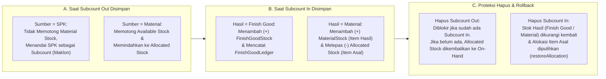

# Dokumentasi & Flowchart Alur Kerja Modul Subcount (Maklon) — PT Trimitra Tumbuh Cemerlang (TTC)

Dokumen ini menjelaskan alur bisnis dan teknis dari **Modul Subcount (Subkontrak / Maklon)** pada sistem ERP PT Trimitra Tumbuh Cemerlang (TTC), mulai dari pengiriman SPK atau material produksi ke vendor maklon (*Subcount Out*), alokasi stok gudang, penerimaan hasil pekerjaan maklon secara parsial maupun penuh (*Subcount In*), hingga penambahan stok otomatis ke Gudang Barang Jadi (*Finish Good Stock*) maupun Gudang Material (*Material Stock*).

---

## 1. Flowchart Utama Modul Subcount (End-to-End)

```mermaid
flowchart TD
    %% Sumber Kebutuhan Subcount
    subgraph Sumber_Kebutuhan["1. Sumber Kebutuhan Subcount (Hulu)"]
        S1["Modul PPIC: Master SPK<br/>(Pesanan Customer dari Sales Order)"]
        S2["Modul Warehouse: Master Item<br/>(Material Produksi / Bahan Baku)"]
        S3["Modul Purchase: Purchase Order (PO)<br/>(PO Type: Subcount & Master Supplier)"]
    end

    %% Tahap Subcount Out
    S1 --> A["2. Subcount Out (Pengiriman ke Vendor Maklon)<br/>Input Tanggal, Pilih Supplier/Vendor, Admin Produksi,<br/>Supervisor & Admin Mainstore"]
    S2 --> A
    S3 -. "Referensi Vendor" .-> A

    A --> B{"Pilih Sumber Item<br/>(sumber_item)"}

    %% Percabangan Sumber Item Subcount Out
    B -- "Sumber: SPK" --> C1["Pilih No. SPK<br/>Otomatis Tarik Nama Produk, Satuan<br/>& Qty Pesanan dari Sales Order"]
    B -- "Sumber: Material" --> C2["Pilih Material (Master Item)<br/>Input Qty Dikirim & Satuan"]

    %% Validasi Stok Material pada Subcount Out
    C2 --> D{"Validasi Stok Gudang<br/>(hasSufficientStock)?"}
    D -- "Stok Kurang" --> D_ERR["Transaksi Ditolak:<br/>Notifikasi Stok Material Tidak Mencukupi"]
    D -- "Stok Cukup" --> E1["Alokasi Stok Material (allocateStock)<br/>On-Hand Berkurang -> Masuk ke Allocated<br/>& Tercatat di Material Ledger"]

    C1 --> F["Terbit Dokumen Subcount Out<br/>No. Otomatis: SUB-OUT/mm-YYYY/000001<br/>+ Indikator Badge SUBCOUNT pada Tabel Master SPK"]
    E1 --> F

    F --> G["Cetak / Download PDF Surat Jalan Subcount Out<br/>& Kirim Fisik Barang ke Vendor Maklon"]

    %% Proses di Vendor & Penerimaan Kembali (Subcount In)
    G --> H["3. Subcount In (Penerimaan Barang dari Vendor)<br/>Input Tanggal, No. SJ Pengiriman Vendor,<br/>Admin Produksi, Supervisor & Admin Mainstore"]

    H --> I["Pilih No. Surat Jalan Subcount Out<br/>Sistem Hitung Otomatis Sisa Belum Diterima:<br/>Outstanding = Total Dikirim - Total Sudah Diterima"]

    I --> J{"Validasi Qty Diterima<br/>(qty_diterima <= Outstanding)?"}
    J -- "Melebihi Sisa (Over-Receiving)" --> J_ERR["Transaksi Ditolak:<br/>Qty Diterima Melebihi Sisa Outstanding"]
    J -- "Valid (Parsial / Penuh)" --> K{"Tipe Barang Diterima<br/>(tipe_hasil)"}

    %% Percabangan Tipe Hasil Subcount In
    K -- "Barang Jadi (Finish Good)<br/>(Default jika asal dari SPK)" --> L1["Pilih Barang Jadi (Finish Good Item)<br/>Otomatis Tambah Stok di Finish Good Stock<br/>(Source: SUBCOUNT_IN) & Finish Good Ledger"]
    K -- "Material Produksi (Master Item)<br/>(Default jika asal dari Material)" --> L2["Pilih Material Hasil (Master Item)<br/>Otomatis Tambah Stok di Material Stock<br/>& Tercatat di Material Ledger"]

    %% Pelepasan Alokasi & Hilir
    L1 --> M["Jika Asal dari Material: Lepas Alokasi Vendor (releaseAllocation)<br/>& Terbit No. Otomatis: SUB-IN/mm-YYYY/000001"]
    L2 --> M

    M --> N["Hilir: Barang Jadi Siap Dikirim via Surat Jalan (Modul Dispatch)<br/>atau Material Hasil Siap Dipakai Produksi Internal"]
```

---

## 2. Flowchart Detail Mutasi Stok & Proteksi Rollback Subcount

---

## 3. Penjelasan Sub-Modul & Layanan Teknis Subcount

### 1. Subcount Out (`SubcountOutResource.php`)
- **Fungsi:** Mencatat pengeluaran barang/pekerjaan dari PT TTC ke vendor subkontrak (*maklon*) beserta pencetakan **Surat Jalan Subcount Out (`SUB-OUT/mm-YYYY/000001`)**.
- **Dua Mode Sumber Item (`sumber_item`):**
  1. **SPK (`spk`):** Digunakan ketika pekerjaan produksi atas pesanan pelanggan (*Sales Order*) disubkontrakkan ke vendor luar. Saat `No SPK` dipilih, sistem otomatis mengisi `Nama Produk`, `Satuan`, dan `Qty` sesuai kuantitas pada *Sales Order*. Selain itu, pada tabel **Master SPK (PPIC)** akan otomatis muncul badge indikator **`SUBCOUNT (MAKLON)`**.
  2. **Master Item / Material Production (`material`):** Digunakan ketika bahan baku dari gudang dikirim ke vendor untuk diolah. Sistem memvalidasi kecukupan stok di gudang sebelum mengizinkan pengiriman dan otomatis mengalokasikan stok tersebut.

### 2. Subcount In (`SubcountInResource.php`)
- **Fungsi:** Mencatat penerimaan kembali barang hasil olahan/cetakan dari vendor maklon ke gudang PT TTC dengan nomor otomatis **`SUB-IN/mm-YYYY/000001`**.
- **Perhitungan Sisa Otomatis (*Partial / Full Receiving*):**
  - Saat memilih nomor `Subcount Out`, sistem menghitung sisa kuantitas yang belum diterima (`calculateOutstandingQty`) sehingga mendukung pengiriman bertahap (parsial) dari vendor.
  - Sistem mencegah *over-receiving* (menerima barang melebihi jumlah yang dikirim pada *Subcount Out*).
- **Dua Mode Barang Diterima (`tipe_hasil`):**
  1. **Barang Jadi / Finish Good (`finish_good`):** Otomatis terpilih apabila referensi asalnya adalah `SPK`. Barang yang diterima langsung menambah saldo di **Finish Good Stocks** (`FinishGoodStockResource.php`) dengan penanda sumber `SUBCOUNT_IN`, sehingga bagian *Dispatch* bisa langsung menerbitkan **Surat Jalan** ke customer.
  2. **Material Produksi (`material`):** Otomatis terpilih apabila referensi asalnya adalah `Material`. Barang hasil olahan yang diterima langsung menambah saldo di **Material Stocks** (`MaterialStockResource.php`) dan melepas status *allocated* pada material asal.

### 3. Service Engine (`SubcontractService.php`)
- Menangani seluruh transaksi database secara atomik (`DB::transaction`) bersama `StockService` dan `FinishGoodStockService`.
- Menjaga integritas stok melalui mekanisme **Proteksi Hapus & Rollback Otomatis**:
  - Dokumen `Subcount Out` yang sudah memiliki riwayat penerimaan `Subcount In` dikunci agar tidak bisa dihapus sembarangan.
  - Apabila dokumen `Subcount In` atau `Subcount Out` (yang belum diterima) dihapus, seluruh alokasi dan penambahan stok di gudang otomatis dikembalikan ke posisi semula (*rollback*).
