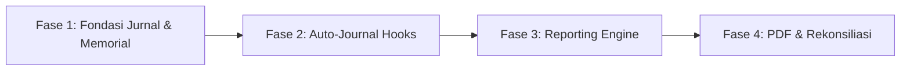

# REKOMENDASI FINAL & ROADMAP PENYEMPURNAAN FINANCE TTC
**Berdasarkan Hasil Audit Forensik Menyeluruh TTC vs Indigama**  
**Entitas Bisnis:** PT Teknografi Tri Cawanaska  
**Workspace:** `C:\xampp\htdocs\TTC-INDIGAMA-COMPARISON`  
**Tanggal:** 2 November 2026  
**Status Sifat:** Rekomendasi Siap Eksekusi (Menunggu Persetujuan Pengguna)

---

## 1. Rangkuman Eksekutif Rekomendasi

Audit forensik terhadap sistem keuangan TTC Laravel dan Program Desktop Indigama membuktikan bahwa:
1. **TTC Laravel** memiliki keunggulan mutlak pada:
   * Fondasi arsitektur web modern berbasis Filament v3.
   * Kelengkapan dan kematangan struktur master COA (255 akun standar industri percetakan).
   * Alur operasional terintegrasi langsung dengan Surat Jalan dan Sales Order riil.
   * Standar integritas database tingkat tinggi (117 Foreign Key constraints).
   * Format dokumen invoice PDF profesional beridentitas resmi **PT Teknografi Tri Cawanaska**.
2. **Indigama Desktop** memiliki keunggulan pada:
   * Penerapan prinsip akuntansi **Double-Entry murni** yang menjamin pembukuan selalu seimbang (`Debet = Kredit`).
   * Adanya modul penyesuaian non-kas (**Jurnal Memorial**).
   * Ketersediaan laporan keuangan manajerial penting: **Laporan Laba Rugi Perusahaan**, **Laporan Neraca Keuangan**, dan **Laporan Laba Rugi per Mesin Cetak**.

**Arah Kebijakan:**
Menyempurnakan TTC Laravel dengan **mengadopsi kecerdasan logika akuntansi dan pelaporan manajerial Indigama**, tanpa mengubah identitas korporat, arsitektur Filament, maupun desain dokumen TTC yang sudah berjalan dengan sangat baik.

---

## 2. Matriks Klasifikasi Rekomendasi Fitur

### 2.1. FITUR YANG DIPERTAHANKAN PENUH DARI TTC (KEEP)
| No | Komponen / Fitur | Alasan Dipertahankan |
| :---: | :--- | :--- |
| 1 | **Tampilan & Navigasi Filament v3** | Antarmuka web modern, responsif, intuitif, dan terbukti stabil untuk operasional harian. |
| 2 | **Master Bagan Akun (255 Akun)** | Struktur akun TTC jauh lebih lengkap, mendalam, dan memenuhi standar audit industri percetakan dibanding Indigama (22 akun). |
| 3 | **Alur Penerbitan Invoice dari Surat Jalan** | Menjamin penagihan hanya terjadi atas barang yang nyata-nyata telah diproduksi dan dikirimkan oleh gudang pabrik. |
| 4 | **Formula Payroll Ketenagakerjaan TTC** | Rumus lembur Depnaker `(1/173 * Gaji Pokok)`, tunjangan jabatan, dan kalkulasi insentif TTC jauh lebih akurat dan taat hukum dibanding Indigama. |
| 5 | **Identitas & Kop Surat PT Teknografi Tri Cawanaska** | Seluruh logo, kop surat, warna korporat (`#31558f`), dan template DomPDF Invoice A5 Landscape wajib dipertahankan 100%. |
| 6 | **Integritas Relasional Database (117 Foreign Key)** | Menjaga basis data terhindar dari data yatim piatu (*orphaned data*). |

---

### 2.2. FITUR YANG DIPERBAIKI / DISEMPURNAKAN DI TTC (ENHANCE)
| No | Komponen / Fitur | Aspek yang Diperbaiki |
| :---: | :--- | :--- |
| 1 | **Form Transaksi Kas (`TransKasResource`)** | Menambahkan kolom `account_lawan_id` (Akun Lawan, wajib diisi) pada form Kas Masuk dan Kas Keluar agar mutasi tidak lagi berdiri sendiri (*single-entry*). |
| 2 | **Posting Pembayaran Invoice (`postInvPayment`)** | Menambahkan baris mutasi otomatis: **KREDIT pada Akun Piutang Usaha (112.001)** saat customer melakukan pembayaran, sehingga saldo piutang di buku besar berkurang berimbang dengan masuknya uang kas/bank. |
| 3 | **Posting Penggajian (`postPayroll`)** | Menambahkan baris mutasi otomatis: **DEBIT pada Akun Beban Gaji & Upah (501.001/601.001)** saat slip gaji berstatus `Paid`, sehingga beban gaji terakumulasi di buku besar. |
| 4 | **Neraca Saldo (`ReportFinaceResource`)** | Menyesuaikan filter tanggal dan penyeimbangan dua sisi agar neraca saldo menunjukkan angka Debet == Kredit secara mutlak. |
| 5 | **Buku Besar Detail (`CoaLedgerResource`)** | Mengoptimalkan tampilan buku besar agar menampilkan akun lawan (*contra-account*) pada setiap baris transaksi. |

---

### 2.3. FITUR BARU YANG DIADOPSI DARI INDIGAMA (ADOPT)
| No | Fitur yang Diadopsi | Deskripsi & Manfaat Penerapan di TTC |
| :---: | :--- | :--- |
| 1 | **Modul Jurnal Memorial / Umum (`JurnalMemorialResource`)** | Mengadopsi fungsi `TranMemorial` Indigama untuk mencatat penyesuaian non-kas, depresiasi aset mesin, dan penutupan buku akhir bulan di Filament TTC. |
| 2 | **Otomatisasi Jurnal Pengakuan Piutang Invoice** | Mengadopsi prinsip akuntansi akrual Indigama: Saat status Invoice disetujui/terbit, sistem otomatis menjurnal: `D: Piutang Usaha (112.001)` dan `K: Pendapatan Penjualan (401.001)` serta `K: PPN Keluaran (214.001)`. |
| 3 | **Laporan Laba Rugi Perusahaan (`ReportLabaRugiResource`)** | Mengadopsi format `LabaRugi.jrxml` Indigama menjadi halaman laporan multi-step di Filament TTC (Pendapatan - HPP = Laba Kotor; Laba Kotor - Beban Operasional = Laba Bersih). |
| 4 | **Laporan Laba Rugi per Mesin Percetakan (`ReportLabaRugiMesinResource`)** | Mengadopsi fitur unggulan `LabaRugiMesin.jrxml` Indigama untuk menganalisis efisiensi dan profitabilitas per unit mesin cetak (Zonten Flexo, Heidelberg Offset, Die-cutting). |
| 5 | **Laporan Neraca Keuangan (`ReportNeracaResource`)** | Mengadopsi format `RNeraca.jrxml` Indigama menjadi laporan posisi keuangan resmi di Filament TTC (Aktiva Lancar/Tetap vs Kewajiban & Ekuitas). |
| 6 | **Voucher Kas & Bank PDF Resmi TTC** | Mengadopsi fungsi cetak voucher kasir Indigama (`TranKas.jrxml` dan `TranBankIn.jrxml`) ke dalam bentuk template DomPDF A5 Landscape bersurat resmi PT Teknografi Tri Cawanaska. |

---

## 3. Rencana Arsitektur Double-Entry Terpadu

Untuk mewujudkan rekomendasi di atas secara elegan dan bersih (*clean code*), lapisan bisnis keuangan TTC disempurnakan dengan membuat **`AccountingJournalService`**:

```php
namespace App\Services\Finance;

use App\Models\CoaMovement;
use App\Models\MasterCOA;
use Illuminate\Support\Facades\DB;

class AccountingJournalService
{
    /**
     * Catat satu set jurnal berpasangan (Double-Entry Balanced Entry)
     * Menjamin Total Debit === Total Kredit
     */
    public function recordDoubleEntry(array $data): void
    {
        DB::transaction(function () use ($data) {
            $refType = $data['reference_type'];
            $refId   = $data['reference_id'];
            $refNo   = $data['reference_no'];
            $tanggal = $data['tanggal'];
            $entries = $data['entries']; // array baris akun: [ ['coa_id' => x, 'debit' => y, 'kredit' => z, 'memo' => '...'] ]

            // 1. Validasi Keseimbangan Matematis
            $totalDebit  = array_sum(array_column($entries, 'debit'));
            $totalKredit = array_sum(array_column($entries, 'kredit'));

            if (round($totalDebit, 2) !== round($totalKredit, 2)) {
                throw new \Exception("Jurnal tidak seimbang: Total Debit (Rp {$totalDebit}) != Total Kredit (Rp {$totalKredit})");
            }

            // 2. Hapus mutasi lama jika transaksi diperbarui
            CoaMovement::where('reference_type', $refType)
                ->where('reference_id', $refId)
                ->delete();

            // 3. Masukkan baris mutasi dan perbarui saldo berjalan
            foreach ($entries as $line) {
                app(TreasuryService::class)->postMovement([
                    'coa_id'         => $line['coa_id'],
                    'tanggal'        => $tanggal,
                    'reference_type' => $refType,
                    'reference_id'   => $refId,
                    'reference_no'   => $refNo,
                    'movement_type'  => $line['debit'] > 0 ? 'DEBIT' : 'KREDIT',
                    'nominal'        => $line['debit'] > 0 ? $line['debit'] : $line['kredit'],
                    'remarks'        => $line['memo'] ?? $data['keterangan'],
                ]);
            }
        });
    }
}
```

---

## 4. Rencana Desain Pelaporan Baru di Filament TTC

Semua laporan baru ditempatkan di dalam grup navigasi `Report` pada Filament Admin:

### 4.1. `ReportLabaRugiResource` (Laporan Laba Rugi)
* **Kategori Navigasi:** `Report` (Sort: 2).
* **Fitur Tampilan:**
  * Widget Ringkasan Finansial: Total Pendapatan, Total HPP, Laba Kotor, Total Beban, dan Laba Bersih.
  * Tabel Detail Berjenjang: Menyajikan kelompok akun Pendapatan (4xx), HPP Bahan & Tenaga Kerja (5xx), Beban Operasional (6xx), dan Pendapatan/Biaya Lain (8xx/9xx).
  * Filter Periode: Pemilihan Bulan & Tahun dengan perbandingan terhadap bulan sebelumnya.
  * Tombol Aksi: Ekspor PDF Laba Rugi resmi bersurat PT Teknografi Tri Cawanaska.

### 4.2. `ReportLabaRugiMesinResource` (Profitabilitas Mesin Percetakan)
* **Kategori Navigasi:** `Report` (Sort: 3).
* **Fitur Tampilan:**
  * Filter Mesin: Pilihan Mesin Flexo Zonten, Offset Heidelberg, Mesin Pond/Die-cut.
  * Kalkulasi: Pendapatan SPK yang dikerjakan mesin terkait dikurangi pemakaian kertas/tinta dan upah operator.
  * Metrik Manajerial: Gross Margin per Mesin Cetak untuk evaluasi produktivitas mesin pabrik.

### 4.3. `ReportNeracaResource` (Laporan Neraca Keuangan)
* **Kategori Navigasi:** `Report` (Sort: 4).
* **Fitur Tampilan:**
  * Penyajian Bersebelahan (Skontro) atau Vertikal (Stafel).
  * Sisi Aktiva: Kas & Bank, Piutang Usaha, Persediaan Bahan Baku & Barang Jadi, Aktiva Tetap Pabrik.
  * Sisi Pasiva: Hutang Usaha Supplier, Hutang Pajak, Modal Saham, dan Laba Tahun Berjalan.
  * Indikator Keseimbangan: Indikator hijau otomatis bertuliskan `Neraca Seimbang (Balanced)` jika Aset == Pasiva.

---

## 5. Rencana Format Dokumen Resmi (DomPDF Templates)

Pembuatan dokumen cetak baru mengikuti standar baku yang sudah ada di `resources/views/pdf/invoice.blade.php`:

1. **Voucher Pengeluaran Kas/Bank (`resources/views/pdf/voucher-kas-keluar.blade.php`):**
   * Ukuran Kertas: A5 Landscape.
   * Kop Surat: **PT Teknografi Tri Cawanaska** dengan logo resmi `public/images/Logo PT Teknografi.png`.
   * Komponen: Nomor Voucher, Tanggal, Dibayarkan Kepada, Akun Kas/Bank, Akun Beban Terkait, Terbilang, dan 4 Kolom Tanda Tangan (Dibuat Oleh, Diperiksa Oleh, Disetujui Direksi, Diterima Oleh).
2. **Voucher Penerimaan Kas/Bank (`resources/views/pdf/voucher-kas-masuk.blade.php`):**
   * Format tanda terima resmi penerimaan uang kas/bank.
3. **Bukti Jurnal Memorial (`resources/views/pdf/bukti-memorial.blade.php`):**
   * Lembar otorisasi penyesuaian pembukuan untuk arsip auditor internal.

---

## 6. Roadmap Tahapan Pelaksanaan (Milestone)



* **Fase 1 (Fondasi Skema & Jurnal Memorial):**
  * Membuat tabel `journal_entries` & `journal_entry_lines`.
  * Menambahkan kolom `account_lawan_id` pada form `trans_kas`.
  * Menerbitkan `JurnalMemorialResource` di Filament.
* **Fase 2 (Otomatisasi Jurnal Berpasangan):**
  * Mengaktifkan hook penjurnalan otomatis saat Invoice terbit (Pengakuan Piutang & Penjualan).
  * Mengaktifkan hook pelunasan piutang pada `InvPayment`.
  * Mengaktifkan hook beban gaji pada `Payroll`.
* **Fase 3 (Mesin Pelaporan Keuangan):**
  * Membangun `ReportLabaRugiResource` (Laba Rugi Perusahaan).
  * Membangun `ReportLabaRugiMesinResource` (Profitabilitas Mesin Cetak).
  * Membangun `ReportNeracaResource` (Neraca Keuangan).
* **Fase 4 (Format Dokumen & Pengujian Terpadu):**
  * Menerbitkan template DomPDF Voucher Kas dan Voucher Bank berlogo TTC.
  * Melakukan rekonsiliasi total piutang, hutang, dan saldo kas bank hingga Neraca Saldo seimbang 100%.

---

## 7. Pernyataan Penutup

Rencana implementasi ini dirancang dengan prinsip kehati-hatian tertinggi:
* **Tidak ada fitur TTC yang dihilangkan.**
* **Tidak ada identitas korporat yang diubah.**
* **Tidak ada koding atau migrasi yang dieksekusi sebelum persetujuan resmi diberikan.**

Audit forensik dan komparasi kini telah lengkap 100%. Tim siap mengeksekusi tahapan implementasi begitu Anda memberikan instruksi persetujuan.

