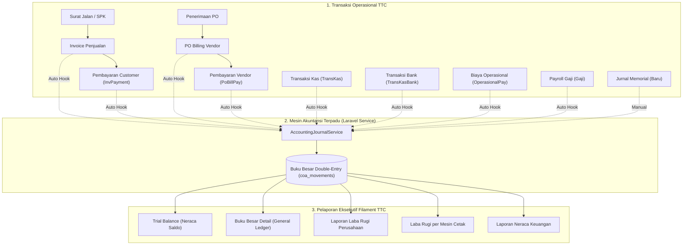

# RENCANA IMPLEMENTASI PENYEMPURNAAN FINANCE TTC
**Berdasarkan Hasil Audit Forensik TTC vs Indigama**  
**Entitas:** PT Teknografi Tri Cawanaska  
**Workspace:** `C:\xampp\htdocs\TTC-INDIGAMA-COMPARISON`  
**Prinsip Utama:** Mengadopsi keunggulan akuntansi *double-entry* dan manajerial percetakan Indigama ke dalam ekosistem modern Laravel Filament TTC, dengan menjaga 100% identitas korporat, arsitektur kode, tampilan UI, dan format dokumen TTC.

---

## 1. Visi & Sasaran Arsitektur Target

Sasaran dari rencana implementasi ini adalah mentransformasikan modul keuangan TTC dari model **Pencatatan Mutasi Tunggal (Single-Entry Cash Tracker)** menjadi **Sistem Akuntansi Korporat Terpadu (Integrated Double-Entry ERP System)** yang siap audit (*audit-ready*).

### Batasan & Prinsip Desain:
1. **100% Identitas TTC:** Seluruh kop surat, logo resmi, tipografi, warna tema (`#31558f`), dan nama entitas **PT Teknografi Tri Cawanaska** dipertahankan secara mutlak. Tidak ada elemen visual Indigama yang disalin.
2. **100% Ekosistem Filament v3:** Seluruh fitur baru diwujudkan dalam bentuk Filament Resources, Pages, Widgets, dan Actions standar.
3. **Integritas Relasional Kuat:** Mempertahankan keunggulan 117 Foreign Key TTC dan menerapkan transaksi database atomik (`DB::transaction`).
4. **Adopsi Logika Akuntansi Indigama:** Mengadopsi prinsip keseimbangan *double-entry* (Debit = Kredit), otomatisasi pengakuan piutang/hutang, dan analisis profitabilitas per mesin percetakan.

---

## 2. Peta Rencana Peningkatan Struktur Database

Penyempurnaan dilakukan tanpa merusak struktur database `ttc` yang ada, melainkan melengkapi kolom dan tabel pendukung akuntansi:

### 2.1. Tabel Baru: `journal_entries` & `journal_entry_lines` (Opsional / Recommended)
Untuk mencatat jurnal umum memorial dan memayungi transaksi multi-baris yang kompleks:
* `journal_entries`: `id`, `kode_jurnal` (format `JRN-Ym-0001`), `tanggal`, `tipe_jurnal` (`GENERAL`, `ADJUSTMENT`, `CLOSING`), `keterangan`, `status` (`POSTED`, `DRAFT`), `created_by`.
* `journal_entry_lines`: `id`, `journal_entry_id`, `coa_id`, `debit`, `kredit`, `memo`.

### 2.2. Penyempurnaan Tabel `trans_kas`
* Menambahkan kolom `account_lawan_id` (Foreign Key ke `master_coas.id`, *nullable* untuk kompatibilitas data lama, namun *required* di form Filament baru) agar transaksi kas keluar/masuk selalu memiliki pasangan akun beban/pendapatan.

### 2.3. Penyempurnaan Tabel `coa_movements`
* Menambahkan kolom `journal_entry_id` dan `partner_coa_id` (Akun Lawan) untuk memudahkan penelusuran buku besar (*contra-account audit*).

---

## 3. Desain Service Layer Akuntansi Baru: `AccountingJournalService`

Membuat service terpusat di `app/Services/Finance/AccountingJournalService.php` yang menggabungkan fungsi `TreasuryService` saat ini dengan aturan jurnal berpasangan otomatis (*Automated Double-Entry Hooks*):

### Matriks Aturan Jurnal Otomatis:

| Sumber Transaksi | Pemicu (Trigger Event) | Akun DEBIT | Akun KREDIT | Keterangan Jurnal |
| :--- | :--- | :--- | :--- | :--- |
| **Penerbitan Invoice** | Status Invoice disetujui / terbit | **Piutang Usaha (112.001)** | **Pendapatan Penjualan (401.001)** *(dan PPN Keluaran 214.001)* | Mengakui piutang pelanggan dan penjualan periode berjalan. |
| **Pembayaran Invoice** | `InvPayment` berhasil dicatat (`SUCCESS`) | **Kas/Bank Terpilih (101.xxx)** | **Piutang Usaha (112.001)** | Mengurangi saldo piutang dan menambah saldo kas/bank. |
| **Tagihan Vendor PO** | `PoBilling` diverifikasi masuk | **Persediaan / HPP Bahan (113.xxx / 501.xxx)** | **Hutang Usaha (211.001)** | Mengakui penambahan bahan/biaya dan kewajiban hutang. |
| **Pembayaran Tagihan PO** | `PoBillPay` dieksekusi | **Hutang Usaha (211.001)** | **Kas/Bank Terpilih (101.xxx)** | Melunasi hutang supplier dan memotong kas/bank. |
| **Kas Masuk** | Transaksi Kas Masuk dibuat | **Kas Terpilih (101.001)** | **Akun Lawan Terpilih (`account_lawan_id`)** | Pencatatan penerimaan kas non-penjualan. |
| **Kas Keluar** | Transaksi Kas Keluar dibuat | **Akun Lawan Terpilih (`account_lawan_id`)** | **Kas Terpilih (101.001)** | Pencatatan pengeluaran kas operasional kecil. |
| **Bank Masuk / Keluar** | Transaksi Bank dibuat | **Akun Penerima (DEBIT)** | **Akun Pengirim (KREDIT)** | Mutasi bank dan penarikan/setoran kas. |
| **Biaya Operasional** | `OperasionalPay` disimpan | **Beban Operasional (`account_beban_id`)** | **Kas/Bank (`account_kas_id`)** | Pengeluaran kas untuk beban departemen. |
| **Penggajian (Payroll)** | Status Slip Gaji diset `Paid` | **Beban Gaji & Upah (501.001 / 601.001)** | **Kas/Bank (`account_kas_id`)** *(dan Potongan Pinjaman 114.001)* | Mengakui beban tenaga kerja dan pengeluaran kas gaji. |
| **Pencairan Kasbon** | Pinjaman Karyawan dicairkan | **Piutang Karyawan (114.001)** | **Kas/Bank (101.xxx)** | Mengakui piutang pinjaman karyawan. |

---

## 4. Rencana Modul Laporan Keuangan Baru di Filament TTC

Menambahkan 4 Resource/Halaman laporan baru di grup menu navigasi `Report` Filament:

### 4.1. Laporan Laba Rugi (`ReportLabaRugiResource`)
* **Tampilan UI:** Ringkasan berjenjang (*multi-step income statement*):
  * **Pendapatan Usaha:** Penjualan Etiket/Label, Penjualan Offset, Pendapatan Jasa Cetak.
  * **Harga Pokok Penjualan (HPP):** Pemakaian Bahan Baku (Kertas, Tinta, Pisau Die-cut, Plate), Upah Tenaga Kerja Langsung, Biaya Overhead Pabrik.
  * **LABA KOTOR (Gross Profit)** = Pendapatan - HPP.
  * **Beban Operasional & Administrasi:** Gaji Manajemen, Listrik Pabrik, Penyusutan Mesin, Pemasaran, ATK Kantor.
  * **LABA OPERASIONAL (Operating Profit)** = Laba Kotor - Beban Operasional.
  * **Pendapatan & Biaya Lain-lain (Non-operasional).**
  * **LABA BERSIH SEBELUM PAJAK (Net Profit Before Tax).**
* **Fitur:** Filter periode bulan/tahun, perbandingan antar periode, dan tombol ekspor PDF resmi.

### 4.2. Laporan Laba Rugi per Mesin Cetak (`ReportLabaRugiMesinResource`)
* **Mengadopsi Fitur Unggulan Indigama:**
  * Menghubungkan nomor mesin cetak (Zonten Flexo, Heidelberg Offset, Mesin Die-cutting) dengan SPK yang diproduksi.
  * Mengkalkulasi pendapatan riil yang dihasilkan mesin vs pemakaian bahan, tinta, listrik mesin, dan biaya operator.
  * Memberikan metrik profitabilitas dan efisiensi per mesin cetak.

### 4.3. Laporan Neraca Keuangan (`ReportNeracaResource`)
* **Tampilan UI:** Standar Neraca Stafel / Skontro:
  * **AKTIVA / ASET:**
    * Aset Lancar (Kas, Bank, Piutang Usaha, Persediaan Bahan, Uang Muka Biaya).
    * Aset Tetap (Mesin Percetakan, Kendaraan, Peralatan Kantor, Akumulasi Penyusutan).
  * **PASIVA (KEWAJIBAN & EKUITAS):**
    * Kewajiban Lancar (Hutang Usaha Supplier, Hutang PPN, Hutang Gaji/Operasional).
    * Ekuitas (Modal Saham, Laba Ditahan, Laba Tahun Berjalan).
  * **Indikator Keseimbangan:** Widget indikator *Balance Check* (Total Aset vs Total Pasiva) yang berwarna hijau jika seimbang sempurna.

### 4.4. Buku Besar Detail (`CoaLedgerResource` Enhanced)
* Mengembangkan halaman Buku Besar yang sudah ada di TTC agar menampilkan buku akun perorangan dengan rincian: Tanggal, No Bukti, Keterangan, Akun Lawan, Mutasi Debet, Mutasi Kredit, dan Saldo Berjalan kumulatif.

---

## 5. Rencana Format Dokumen Resmi (DomPDF Templates)

Membuat template dokumen PDF baru dengan tetap mengacu pada standar visual `resources/views/pdf/invoice.blade.php`:

1. **Voucher Pengeluaran Kas / Bank (*Payment Voucher*):**
   * Format: A5 Landscape.
   * Kop Surat: **PT Teknografi Tri Cawanaska** lengkap dengan logo resmi.
   * Rincian: Dibayarkan kepada, Jumlah nominal, Terbilang, Akun Debet/Kredit, Keterangan, Otorisasi Tanda Tangan (Disetujui, Diperiksa, Dibayar, Diterima).
2. **Voucher Penerimaan Kas / Bank (*Receipt Voucher*):**
   * Format: A5 Landscape resmi untuk tanda terima setoran tunai/transfer.
3. **Rekap Slip Gaji Karyawan Resmi:**
   * Format cetak slip gaji individual berbasis DomPDF bersurat resmi TTC.

---

## 6. Tahapan Eksekusi Rencana (Roadmap)

Pelaksanaan dibagi ke dalam 4 fase terstruktur yang aman dan dapat diuji secara bertahap:

### FASE 1: Fondasi Skema Database & Jurnal Memorial
* Penambahan kolom `account_lawan_id` pada form `trans_kas`.
* Pembuatan skema `journal_entries` dan `journal_entry_lines`.
* Pembuatan resource Filament `JurnalMemorialResource` untuk transaksi penyesuaian non-kas.
* Waktu estimasi: 1 Sprint.

### FASE 2: Otomatisasi Posting Jurnal (Double-Entry Engine)
* Implementasi `AccountingJournalService` untuk menangani hook otomatis:
  * Hook Invoice terbit (Pengakuan Piutang & Penjualan).
  * Hook InvPayment (Pelunasan Piutang).
  * Hook PoBillPay (Pelunasan Hutang Supplier).
  * Hook Gaji (Pencatatan Beban Gaji).
* Uji coba posting transaksi berimbang pada lingkungan *sandbox*.
* Waktu estimasi: 1 Sprint.

### FASE 3: Pelaporan Keuangan Komprehensif
* Pembuatan halaman `ReportLabaRugiResource` (Laba Rugi Perusahaan).
* Pembuatan halaman `ReportLabaRugiMesinResource` (Profitabilitas Mesin Percetakan).
* Pembuatan halaman `ReportNeracaResource` (Neraca Keuangan).
* Penyempurnaan `ReportFinaceResource` (Trial Balance) agar seimbang 100%.
* Waktu estimasi: 1-2 Sprint.

### FASE 4: Templat Dokumen Resmi & Validasi Forensik Akhir
* Pembuatan template PDF Voucher Kas, Voucher Bank, dan Bukti Memorial berbasis DomPDF dengan kop surat PT Teknografi Tri Cawanaska.
* Rekonsiliasi saldo akun dan pengujian *end-to-end* siklus akuntansi dari Order hingga Laporan Keuangan.
* Waktu estimasi: 1 Sprint.

---

## 7. Strategi Pengujian & Rekonsiliasi Saldo

Sebelum modul diserahkan kepada pengguna operasional, pengujian ketat dilakukan dengan skenario:
1. **Zero Balance Equation Check:** Memastikan bahwa kueri `SELECT SUM(debit) - SUM(kredit) FROM coa_movements` selalu menghasilkan angka `0.00` (seimbang mutlak).
2. **Rekonsiliasi Piutang:** Memastikan total `sisa_tagihan` pada seluruh invoice aktif sama persis dengan saldo akhir akun Piutang Usaha (112.001) di Buku Besar.
3. **Rekonsiliasi Hutang:** Memastikan total sisa tagihan pada `po_billings` sama persis dengan saldo akhir akun Hutang Usaha (211.001) di Buku Besar.
4. **Rekonsiliasi Kas/Bank:** Memastikan saldo fisik rekening bank dan kas kecil sama persis dengan saldo akun kepala 101 di Neraca.

