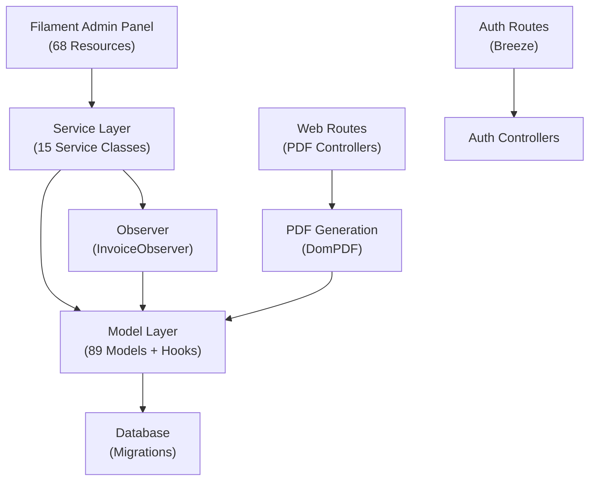
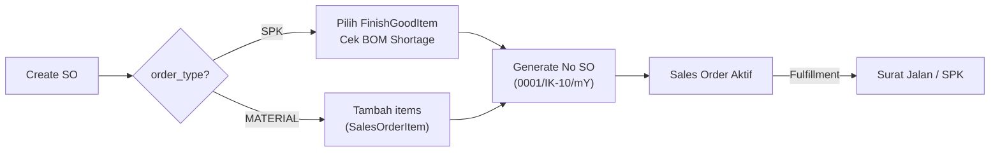
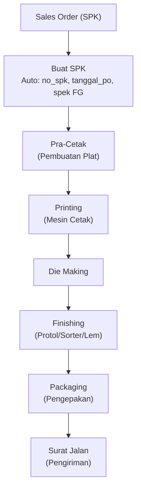
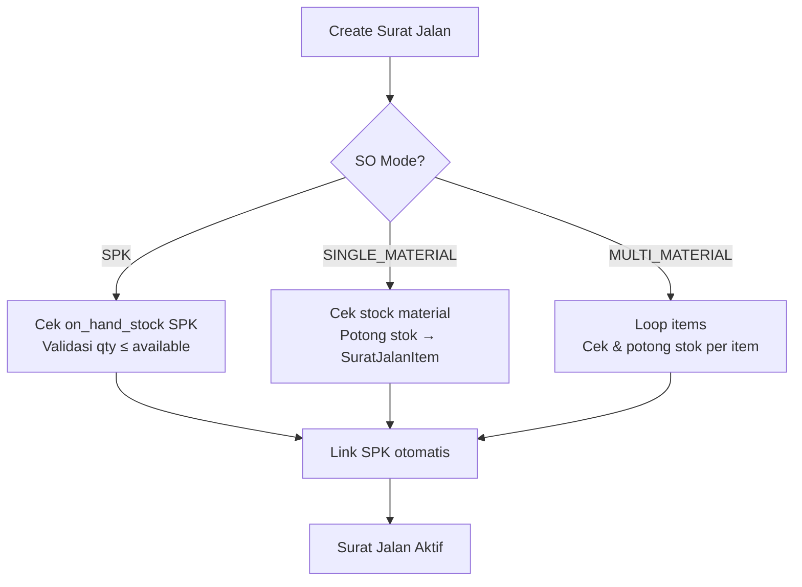
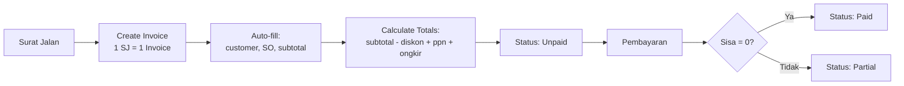
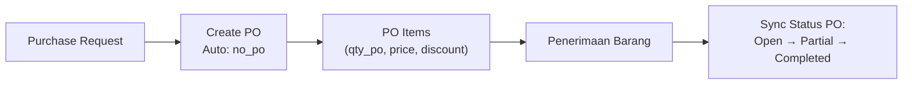
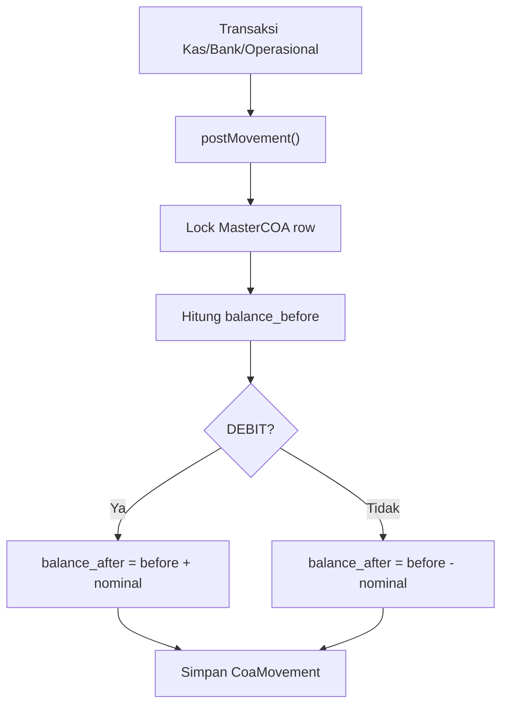
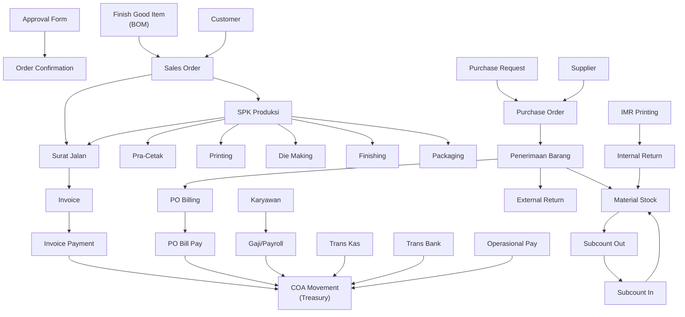

# 🔍 Analisis Jalur Logic Seluruh Fitur — Management PT TTC

> **Project**: Laravel 10 + Filament Admin Panel  
> **Total Filament Resources**: 68 modul  
> **Total Models**: 89 file  
> **Total Services**: 15 domain service  

---

## 📊 Ringkasan Arsitektur



---

## 🏢 MODUL 1: MARKETING & SALES

### 1.1 Approval Form
| Aspek | Detail |
|-------|--------|
| **Resource** | [ApprovalFormResource.php](file:///c:/xampp/htdocs/management-pt-ttc-1%20-%20Copy/app/Filament/Admin/Resources/ApprovalFormResource.php) |
| **Model** | [ApprovalForm.php](file:///c:/xampp/htdocs/management-pt-ttc-1%20-%20Copy/app/Models/ApprovalForm.php) |
| **PDF** | [ApprovalFormPdfController.php](file:///c:/xampp/htdocs/management-pt-ttc-1%20-%20Copy/app/Http/Controllers/ApprovalFormPdfController.php) |
| **Logic Flow** | Create → Load customer & items → PDF Preview/Download |
| **Proteksi** | ❌ Tidak ada proteksi hapus |

### 1.2 Order Confirmation
| Aspek | Detail |
|-------|--------|
| **Resource** | [OrderConfirmationResource.php](file:///c:/xampp/htdocs/management-pt-ttc-1%20-%20Copy/app/Filament/Admin/Resources/OrderConfirmationResource.php) (39KB - terbesar) |
| **Model** | [OrderConfirmation.php](file:///c:/xampp/htdocs/management-pt-ttc-1%20-%20Copy/app/Models/OrderConfirmation.php) |
| **PDF** | [OrderConfirmationPdfController.php](file:///c:/xampp/htdocs/management-pt-ttc-1%20-%20Copy/app/Http/Controllers/OrderConfirmationPdfController.php) |
| **Logic Flow** | Create → Link ke ApprovalForm → Load items & FinishGoodItem → PDF |
| **Proteksi** | ❌ Tidak ada proteksi hapus |

### 1.3 Finish Good Item (BOM)
| Aspek | Detail |
|-------|--------|
| **Resource** | [FinishGoodItemResource.php](file:///c:/xampp/htdocs/management-pt-ttc-1%20-%20Copy/app/Filament/Admin/Resources/FinishGoodItemResource.php) (29KB) |
| **Model** | [FinishGoodItem.php](file:///c:/xampp/htdocs/management-pt-ttc-1%20-%20Copy/app/Models/FinishGoodItem.php) |
| **Logic Flow** | Master BOM → Simpan materials (qty per unit) → Dipakai oleh SO & SPK |
| **Proteksi** | ❌ Perlu cek apakah sudah dipakai di SO sebelum hapus |

---

## 📦 MODUL 2: SALES ORDER

### 2.1 Sales Order
| Aspek | Detail |
|-------|--------|
| **Resource** | [SalesOrderResource.php](file:///c:/xampp/htdocs/management-pt-ttc-1%20-%20Copy/app/Filament/Admin/Resources/SalesOrderResource.php) (30KB) |
| **Model** | [SalesOrder.php](file:///c:/xampp/htdocs/management-pt-ttc-1%20-%20Copy/app/Models/SalesOrder.php) |
| **Service** | [SalesOrderService.php](file:///c:/xampp/htdocs/management-pt-ttc-1%20-%20Copy/app/Services/Sales/SalesOrderService.php) |
| **PDF** | [SalesOrderPdfController.php](file:///c:/xampp/htdocs/management-pt-ttc-1%20-%20Copy/app/Http/Controllers/SalesOrderPdfController.php) |

**Logic Flow:**



**Proteksi:**
- ✅ **Creating**: Auto-generate `no_sales_order` jika kosong
- ✅ **Deleting**: Block jika sudah ada Surat Jalan ATAU SPK
- ✅ **BOM Check**: Validasi ketersediaan bahan baku saat create/update (mode SPK)
- ✅ **Soft Deletes**: Menggunakan `SoftDeletes` trait

**Fulfillment Status:**
- `BELUM DIKIRIM` → delivered_qty = 0
- `DIKIRIM SEBAGIAN` → delivered_qty > 0 tapi < order_qty
- `SELESAI` → delivered_qty >= order_qty

---

## 🏭 MODUL 3: PRODUKSI (SPK)

### 3.1 Surat Perintah Kerja (SPK)
| Aspek | Detail |
|-------|--------|
| **Resource** | [SuratPerintahKerjaResource.php](file:///c:/xampp/htdocs/management-pt-ttc-1%20-%20Copy/app/Filament/Admin/Resources/SuratPerintahKerjaResource.php) (19KB) |
| **Model** | [MasterSpk.php](file:///c:/xampp/htdocs/management-pt-ttc-1%20-%20Copy/app/Models/MasterSpk.php) |
| **Service** | [ProductionService.php](file:///c:/xampp/htdocs/management-pt-ttc-1%20-%20Copy/app/Services/Production/ProductionService.php) |

**Logic Flow (Stasiun Produksi):**



**Proteksi:**
- ✅ **Creating**: Auto-generate `no_spk` format `{count}/SPK-IK{kode_ik}/{mY}`
- ✅ **Creating**: Sinkron `tanggal_po` dari Sales Order
- ✅ **Creating**: Salin spesifikasi dari FinishGoodItem (up_satu, ukuran_cetak, dll)
- ✅ **Creating**: Validasi `order_type` harus SPK, cegah double SPK per SO
- ✅ **Deleting**: Block jika ada Surat Jalan, Packaging, Finishing, Printing, atau Pra-Cetak
- ✅ **Complete**: SPK hanya boleh FINISH jika sudah ada packaging hasil baik

**Stok Tracking SPK:**
- `on_hand_stock` = total_good_packed - total_shipped
- `completion_rate` = (total_good_packed / order_qty) × 100

### 3.2 Packaging
| Logic | Detail |
|-------|--------|
| **Create** | Hitung total: `(jumlah_penuh × qty_penuh) + (jumlah_sisa × qty_sisa)` |
| **Proteksi Hapus** | ✅ Block jika `on_hand` setelah hapus < `total_shipped` (stok sudah terkirim) |
| **Jenis Transfer** | `blokir` = barang cacat, tidak masuk stok siap kirim |

### 3.3 Pracetak / Printing / Finishing / Die Making
| Logic | Detail |
|-------|--------|
| **Create** | Validasi `spk_id` wajib, auto-fill tanggal |
| **Tracking** | Sum `hasil_baik` dan `hasil_rusak + semi_waste` |

---

## 🚛 MODUL 4: DISPATCH (SURAT JALAN)

### 4.1 Surat Jalan
| Aspek | Detail |
|-------|--------|
| **Resource** | [SuratJalanResource.php](file:///c:/xampp/htdocs/management-pt-ttc-1%20-%20Copy/app/Filament/Admin/Resources/SuratJalanResource.php) (19KB) |
| **Model** | [SuratJalan.php](file:///c:/xampp/htdocs/management-pt-ttc-1%20-%20Copy/app/Models/SuratJalan.php) |
| **Service** | [SuratJalanService.php](file:///c:/xampp/htdocs/management-pt-ttc-1%20-%20Copy/app/Services/Dispatch/SuratJalanService.php) |
| **PDF** | [SuratJalanPdfController.php](file:///c:/xampp/htdocs/management-pt-ttc-1%20-%20Copy/app/Http/Controllers/SuratJalanPdfController.php) |

**Logic Flow per Mode SO:**



**Proteksi:**
- ✅ **Creating**: Auto-generate `kode_surat_jalan` format `SJ-YYYYMMDD-XXX`
- ✅ **Creating**: Auto-link `spk_id` untuk mode SPK
- ✅ **Creating**: Validasi stok SPK & material sebelum simpan
- ✅ **Updating**: Rollback stok lama → terapkan stok baru (dalam DB transaction)
- ✅ **Deleting**: Block jika sudah ada Invoice terkait
- ✅ **Deleting**: Rollback kembalikan stok material yang terpotong
- ✅ **Deleting**: Hapus SuratJalanItem (cascade manual)

---

## 💰 MODUL 5: FINANCE — INVOICE & PEMBAYARAN

### 5.1 Invoice
| Aspek | Detail |
|-------|--------|
| **Resource** | [InvoiceResource.php](file:///c:/xampp/htdocs/management-pt-ttc-1%20-%20Copy/app/Filament/Admin/Resources/InvoiceResource.php) (23KB) |
| **Model** | [invoice.php](file:///c:/xampp/htdocs/management-pt-ttc-1%20-%20Copy/app/Models/invoice.php) |
| **Service** | [InvoiceService.php](file:///c:/xampp/htdocs/management-pt-ttc-1%20-%20Copy/app/Services/Finance/InvoiceService.php) |
| **Observer** | [InvoiceObserver.php](file:///c:/xampp/htdocs/management-pt-ttc-1%20-%20Copy/app/Observers/InvoiceObserver.php) |
| **PDF** | [InvoicePdfController.php](file:///c:/xampp/htdocs/management-pt-ttc-1%20-%20Copy/app/Http/Controllers/InvoicePdfController.php) |

**Logic Flow:**



**Kalkulasi Finansial:**
```
diskon_nominal = subtotal × diskon_persen / 100
ppn_nominal = subtotal × ppn_persen / 100
grand_total = subtotal - diskon_nominal + ppn_nominal + ongkir
total_payment = uang_muka + sum(payments WHERE status='SUCCESS')
sisa_tagihan = max(0, grand_total - total_payment)
```

**Proteksi:**
- ✅ **Creating**: Auto-generate `kode_invoice` format `000001/INV/mY`
- ✅ **Creating**: Cegah duplikasi (1 Surat Jalan = 1 Invoice)
- ✅ **Observer**: Sinkronisasi finansial otomatis saat creating/updating
- ✅ **Deleting**: Block jika sudah ada riwayat pembayaran (double guard: Model + Observer)
- ✅ **Terbilang**: Auto-generate angka ke teks Indonesia (Satu, Dua, Tiga...)

> [!WARNING]
> **Duplikasi logic deleting** ditemukan: Ada di Model `booted()` DAN di `InvoiceObserver`. Observer dan Model hooks bisa terpanggil dua kali.

### 5.2 Invoice Payment (InvPayment)
| Aspek | Detail |
|-------|--------|
| **Resource** | [InvPaymentResource.php](file:///c:/xampp/htdocs/management-pt-ttc-1%20-%20Copy/app/Filament/Admin/Resources/InvPaymentResource.php) (11KB) |
| **Service** | [InvoicePaymentService.php](file:///c:/xampp/htdocs/management-pt-ttc-1%20-%20Copy/app/Services/Finance/InvoicePaymentService.php) |
| **Logic** | Bayar → Refresh sisa tagihan → Update status Invoice → Post ke Treasury (COA Movement) |
| **Treasury** | ✅ Otomatis posting DEBIT ke Kas/Bank saat pembayaran SUCCESS |

---

## 🛒 MODUL 6: PURCHASING

### 6.1 Purchase Request
| Aspek | Detail |
|-------|--------|
| **Resource** | [PurchaseRequestResource.php](file:///c:/xampp/htdocs/management-pt-ttc-1%20-%20Copy/app/Filament/Admin/Resources/PurchaseRequestResource.php) |
| **PDF** | [PurchaseRequestPdfController.php](file:///c:/xampp/htdocs/management-pt-ttc-1%20-%20Copy/app/Http/Controllers/PurchaseRequestPdfController.php) |
| **Logic Flow** | Create PR → Items → Approve → Jadi PO |
| **Status** | draft → otorisasi (saat PO dibuat) → deotorisasi (saat PO dihapus) |

### 6.2 Purchase Order
| Aspek | Detail |
|-------|--------|
| **Resource** | [PurchaseOrderResource.php](file:///c:/xampp/htdocs/management-pt-ttc-1%20-%20Copy/app/Filament/Admin/Resources/PurchaseOrderResource.php) (21KB) |
| **Model** | [PurchaseOrder.php](file:///c:/xampp/htdocs/management-pt-ttc-1%20-%20Copy/app/Models/PurchaseOrder.php) |
| **Service** | [PurchaseOrderService.php](file:///c:/xampp/htdocs/management-pt-ttc-1%20-%20Copy/app/Services/PurchaseOrder/PurchaseOrderService.php) |
| **PDF** | [PurchaseOrderPdfController.php](file:///c:/xampp/htdocs/management-pt-ttc-1%20-%20Copy/app/Http/Controllers/PurchaseOrderPdfController.php) |

**Logic Flow:**



**Proteksi:**
- ✅ **Creating**: Auto-generate `no_po` format `PO-UGRMS-YYYYMMDD-XXX`
- ✅ **Creating**: Update status PR ke `otorisasi`
- ✅ **Updating**: Smart sync items (jaga `qty_received`), validasi qty_po ≥ qty_received
- ✅ **Deleting**: Block jika ada Penerimaan Barang, PO Billing, atau Faktur
- ✅ **Deleting**: Rollback status PR ke `deotorisasi`

### 6.3 Penerimaan Barang (LPB)
| Aspek | Detail |
|-------|--------|
| **Resource** | [PenerimaanBarangResource.php](file:///c:/xampp/htdocs/management-pt-ttc-1%20-%20Copy/app/Filament/Admin/Resources/PenerimaanBarangResource.php) |
| **Model** | [PenerimaanBarang.php](file:///c:/xampp/htdocs/management-pt-ttc-1%20-%20Copy/app/Models/PenerimaanBarang.php) |
| **Service** | [PenerimaanBarangService.php](file:///c:/xampp/htdocs/management-pt-ttc-1%20-%20Copy/app/Services/PurchaseOrder/PenerimaanBarangService.php) |

**Logic Flow:**
1. **Create** → `processReceiving()`: Loop items → `StockService.increaseStock()` + `increment qty_received` pada PO Item
2. **Sync PO Status**: Otomatis update status PO (Open/Partial/Completed)
3. **Delete** → Block jika ada PO Billing atau External Return → Rollback stok → Decrement qty_received → Resync PO status

---

## 💳 MODUL 7: FINANCE — TAGIHAN SUPPLIER

### 7.1 PO Billing (Tagihan Supplier)
| Aspek | Detail |
|-------|--------|
| **Resource** | [PoBillingResource.php](file:///c:/xampp/htdocs/management-pt-ttc-1%20-%20Copy/app/Filament/Admin/Resources/PoBillingResource.php) (16KB) |
| **Service** | [PoBillingService.php](file:///c:/xampp/htdocs/management-pt-ttc-1%20-%20Copy/app/Services/Finance/PoBillingService.php) |

**Kalkulasi:**
```
subtotal_item = (qty × harga) - (qty × harga × diskon / 100)
total_barang = sum(subtotal_item)
grand_total = max(0, total_barang + ppn + ongkir - dp)
```

**Proteksi:**
- ✅ Cegah duplikasi: 1 Penerimaan Barang = 1 PO Billing
- ✅ Hapus: Block jika sudah ada pembayaran

### 7.2 PO Bill Pay (Pembayaran Tagihan)
| Aspek | Detail |
|-------|--------|
| **Service** | [PoBillPayService.php](file:///c:/xampp/htdocs/management-pt-ttc-1%20-%20Copy/app/Services/Finance/PoBillPayService.php) |
| **Logic** | Bayar → Validasi total ≤ sisa tagihan → Post ke Treasury (KREDIT kas/bank + DEBIT hutang dagang) |
| **Proteksi** | ✅ Cegah overpayment, ✅ Mutasi Treasury otomatis saat create/update/delete |

---

## 🏦 MODUL 8: TREASURY (KAS & BANK)

### 8.1 Transaksi Kas / Bank / Operasional
| Aspek | Detail |
|-------|--------|
| **Service** | [TreasuryService.php](file:///c:/xampp/htdocs/management-pt-ttc-1%20-%20Copy/app/Services/Finance/TreasuryService.php) (801 baris - terbesar) |
| **Resources** | TransKasResource, TransKasBankResource, OperasionalPayResource |

**Running Balance Engine:**



**Jenis Transaksi & Jurnal:**
| Transaksi | Akun Utama | Akun Lawan |
|-----------|-----------|-----------|
| KAS_MASUK | DEBIT (kas bertambah) | KREDIT (sumber) |
| KAS_KELUAR | KREDIT (kas berkurang) | DEBIT (tujuan) |
| BANK_MASUK | DEBIT (bank bertambah) | KREDIT (sumber) |
| BANK_KELUAR | KREDIT (bank berkurang) | DEBIT (tujuan) |
| OPERASIONAL | KREDIT (kas keluar) | DEBIT (beban) |
| INV_PAYMENT | DEBIT (kas masuk dari customer) | — |
| PO_BILL_PAY | KREDIT (kas keluar ke supplier) | DEBIT (hutang berkurang) |
| PAYROLL | KREDIT (kas keluar bayar gaji) | — |

**Proteksi:**
- ✅ `lockForUpdate()` pada MasterCOA → anti race condition
- ✅ `recalculateRunningBalances()` → hitung ulang saldo berurutan
- ✅ `canDeleteCoa()` → cek referensi di semua modul sebelum hapus akun COA

---

## 📦 MODUL 9: INVENTORY & STOK

### 9.1 Material Stock
| Aspek | Detail |
|-------|--------|
| **Service** | [StockService.php](file:///c:/xampp/htdocs/management-pt-ttc-1%20-%20Copy/app/Services/Inventory/StockService.php) |

**Operasi Stok:**
| Method | Efek | Dipakai Oleh |
|--------|------|-------------|
| `increaseStock()` | on_hand ↑ | Penerimaan Barang, Rollback SJ, Subcount In |
| `decreaseStock()` | on_hand ↓ | Surat Jalan (material), Rollback PB, Rollback Subcount In |
| `allocateStock()` | on_hand ↓, allocation ↑ | Subcount Out |
| `deallocateStock()` | on_hand ↑, allocation ↓ | Rollback Subcount Out |
| `releaseAllocation()` | allocation ↓ | Subcount In (setelah diterima) |
| `restoreAllocation()` | allocation ↑ | Rollback Subcount In |
| `checkBomShortages()` | Validasi BOM | Sales Order (mode SPK) |

**Proteksi:**
- ✅ `lockForUpdate()` pada MaterialStock → anti race condition
- ✅ Validasi stok mencukupi sebelum decrease (kecuali `allowNegative`)
- ✅ Setiap mutasi tercatat di `MaterialMovement` (audit trail)

---

## 🔄 MODUL 10: SUBCONTRACT

### 10.1 Subcount Out (Kirim ke Vendor)
| Aspek | Detail |
|-------|--------|
| **Service** | [SubcontractService.php](file:///c:/xampp/htdocs/management-pt-ttc-1%20-%20Copy/app/Services/Subcontract/SubcontractService.php) |

**Logic Flow:**
1. Validasi stok material mencukupi
2. `allocateStock()` → pindah on_hand ke allocation
3. Hapus: Block jika ada Subcount In → rollback `deallocateStock()`

### 10.2 Subcount In (Terima dari Vendor)
**Logic Flow:**
1. Validasi over-receiving per item (qty ≤ outstanding)
2. `increaseStock()` untuk item hasil (barang jadi)
3. `releaseAllocation()` untuk item asal
4. Hapus: `decreaseStock()` item hasil + `restoreAllocation()` item asal

---

## 🔙 MODUL 11: RETUR

### 11.1 External Return (Retur ke Supplier)
| Aspek | Detail |
|-------|--------|
| **Service** | [ExternalReturnService.php](file:///c:/xampp/htdocs/management-pt-ttc-1%20-%20Copy/app/Services/ExternalReturn/ExternalReturnService.php) |

**Status Flow:** `draft` → `approved` → `cancel`
- **Approve**: Validasi stok → decrement `on_hand`
- **Cancel**: increment `on_hand` (kembalikan stok)
- **Edit**: Block jika sudah `approved`

### 11.2 Internal Return (Retur Material Produksi)
| Aspek | Detail |
|-------|--------|
| **Service** | [InternalReturnService.php](file:///c:/xampp/htdocs/management-pt-ttc-1%20-%20Copy/app/Services/InternalReturn/InternalReturnService.php) |

**Status Flow:** `draft` → `approved` → `cancel`
- **Approve**: Validasi qty ≤ available return → increment `qty_returned` di IMR Item → increment `on_hand`
- **Cancel**: decrement `qty_returned` → decrement `on_hand`

---

## 👷 MODUL 12: HR & PAYROLL

### 12.1 Gaji (Payroll)
| Aspek | Detail |
|-------|--------|
| **Resource** | [GajiResource.php](file:///c:/xampp/htdocs/management-pt-ttc-1%20-%20Copy/app/Filament/Admin/Resources/GajiResource.php) (20KB) |
| **Service** | [PayrollService.php](file:///c:/xampp/htdocs/management-pt-ttc-1%20-%20Copy/app/Services/HR/PayrollService.php) |

**Kalkulasi Auto:**
```
total_pendapatan = gaji_pokok + tunjangan_jabatan + tunjangan_kompetensi 
                 + tunjangan_intensif + total_lembur + total_bonus
total_potongan   = potongan_tunjangan + potongan_kehadiran 
                 + potongan_pinjaman + potongan_bpjs
gaji_bersih      = max(0, total_pendapatan - total_potongan)

rate_lembur      = gaji_pokok / 173  (standar jam kerja/bulan)
total_lembur     = durasi_lembur × rate_lembur
```

**Proteksi:**
- ✅ Cegah double payroll: 1 karyawan per periode
- ✅ Status `Paid` → otomatis posting ke Treasury (KREDIT kas/bank)
- ✅ Update/Delete → sinkron mutasi di Treasury

### 12.2 Modul HR Lainnya
| Fitur | Resource |
|-------|----------|
| Karyawan | KaryawanResource |
| Lembur | LemburResource |
| Bonus | BonusKaryawanResource |
| Cuti | CutiResource |
| Izin | IzinResource |
| Absensi | AbsensiResource |
| Potongan Tunjangan | PotTunjanganResource |
| Pengajuan Pinjaman | PengPinjamanResource |
| Pembayaran Pinjaman | PembPinjamanResource |
| Hari Libur | HariLiburResource |

---

## 📄 MODUL 13: PDF GENERATION

| Dokumen | Controller | Paper | Auth? |
|---------|-----------|-------|-------|
| Invoice | InvoicePdfController | A5 Landscape | ✅ |
| Surat Jalan | SuratJalanPdfController | Default | ✅ |
| Sales Order | SalesOrderPdfController | Default | ❌ |
| Approval Form | ApprovalFormPdfController | A4 Landscape | ❌ |
| Order Confirmation | OrderConfirmationPdfController | A4 Landscape | ❌ |
| Purchase Request | PurchaseRequestPdfController | Default | ❌ |
| Purchase Order | PurchaseOrderPdfController | Default | ❌ |
| Subcount In | SubcountInPdfController | Default | ❌ |
| Subcount Out | SubcountOutPdfController | Default | ❌ |
| Penerimaan Barang | Inline Route Closure | Default | ❌ |
| External Return | ExternalReturnPdfController | Default | ❌ |
| IMR Printing | IMRPrintingPdfController | Default | ❌ |
| Berita Acara | BeritaAcaraPdfController | A4 Portrait | ✅ |

> [!WARNING]
> **Masalah keamanan**: Sebagian besar route PDF **tidak dilindungi middleware `auth`**. Siapa saja yang tahu URL bisa mengakses dokumen.

---

## ⚠️ TEMUAN MASALAH & RISIKO

### 🔴 Kritis

1. **Route duplikat** di [web.php](file:///c:/xampp/htdocs/management-pt-ttc-1%20-%20Copy/routes/web.php):
   - Route `purchase-request.preview` didefinisikan **2 kali** (line 111-115 dan 118-121)
   - Route `profile.edit`, `profile.update`, `profile.destroy` didefinisikan **2 kali** (line 105-107 dan 238-251)

2. **PDF routes tanpa auth**: Sales Order, Approval Form, Order Confirmation, Purchase Request, Purchase Order, Subcount In/Out, External Return, IMR → semua **tanpa middleware `auth`**

3. **Duplikasi deleting guard pada Invoice**: Logic `deleting` ada di Model `booted()` DAN di `InvoiceObserver` → bisa terjadi double throw exception

### 🟡 Peringatan

4. **Penerimaan Barang PDF**: Menggunakan inline closure di routes alih-alih controller → tidak konsisten dengan pattern lainnya

5. **File backup `.bak`** masih ada di Resources directory:
   - `InvPaymentResource.php.before-checkbox.bak`
   - `InvoiceResource.php.before-checkbox.bak`
   - `OperasionalPayResource.php.before-checkbox.bak`
   - `TransFakturResource.php.before-checkbox.bak`
   - `TransKasBankResource.php.before-checkbox.bak`
   - `TransKasResource.php.before-checkbox.bak`

6. **Model naming inconsistency**: `invoice.php` (lowercase) vs semua model lain (PascalCase)

7. **External Return cancel**: Status diubah ke `cancel` (bukan `cancelled`) → perlu cek konsistensi

### 🟢 Baik

8. ✅ Semua operasi stok menggunakan `DB::transaction()` + `lockForUpdate()` (anti race condition)
9. ✅ Proteksi hapus cascading: Setiap entity downstream melindungi entity upstream dari penghapusan
10. ✅ Auto-numbering konsisten di semua modul
11. ✅ Treasury running balance engine solid dengan `recalculateRunningBalances()`
12. ✅ Rollback stok saat delete Surat Jalan, Penerimaan Barang, Subcount In/Out
13. ✅ BOM shortage check sebelum buat Sales Order SPK
14. ✅ Service layer terpisah dan bersih — tidak ada logic bisnis di controller/resource

---

## 📋 Peta Relasi Antar Entitas


